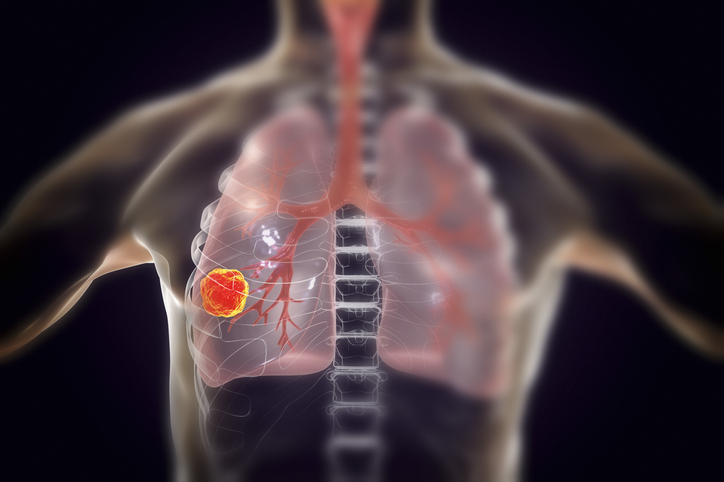
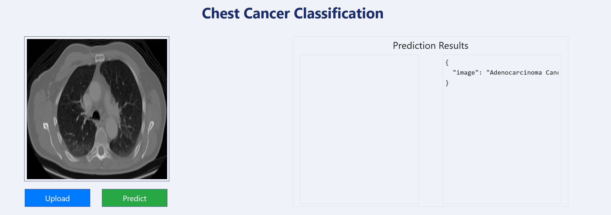
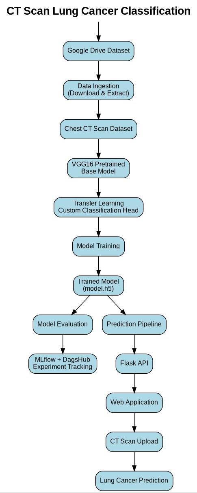

<div align="justify">

# CT-Scan-Lung-Cancer-Classification




## Project Overview 

Early detection of lung cancer significantly improves patient survival rates. This project implements a Deep Learning computer vision pipeline to classify chest Computed Tomography (CT) scans into four distinct categories: Adenocarcinoma, Large Cell Carcinoma, Squamous Cell Carcinoma, and Normal (Non-Cancerous).

Designed as a clinical decision-support tool, this system aims to assist radiologists by providing rapid, automated preliminary screenings of chest CT imagery.

## Problem Statement:
Lung cancer remains one of the leading causes of cancer-related deaths worldwide, where early and accurate diagnosis is critical for significantly improving patient survival rates. However, manual interpretation of chest CT-scans is time-consuming, highly dependent on specialist expertise, and prone to human subjectivity or fatigue, which can lead to delayed detection and treatment for patients.

## Solution:
To address this challenge, this project implements a deep learning-based computer vision system designed to automatically analyze and classify chest CT-scan images into normal tissue and distinct cancer categories (such as adenocarcinoma, large cell carcinoma, and squamous cell carcinoma). By leveraging convolutional neural networks (CNNs) and transfer learning, the model provides rapid, objective, and accurate predictions to assist healthcare professionals in early screening, reducing diagnostic bottlenecks, and improving clinical outcomes.

## Limitations & Future Work

3D Volumetric Context: Currently, the model evaluates 2D slices independently. Future iterations will explore 3D CNNs or Vision Transformers (ViTs) to capture spatial context across full CT scan volumes (DICOM format).

External Validation: The model needs validation against multi-center clinical datasets to ensure generalizability across different CT scanner manufacturers.

## App Demo 


## Flow Diagram




## Folder Structure 

```python
CT-Scan-Lung-Cancer-Classification/
│
├── .github/
│   └── workflows/
│       └── .gitkeep
│
├── artifacts/
│   ├── data_ingestion/
│   │   ├── data.zip
│   │   └── Chest-CT-Scan-data/
│   │
│   ├── prepare_base_model/
│   │   ├── base_model.h5
│   │   └── base_model_updated.h5
│   │
│   └── training/
│       └── model.h5
│
├── config/
│   └── config.yaml
│
├── logs/
│   └── running_logs.log
│
├── research/
│   └── trials.ipynb
│
├── src/
│   └── cnnClassifier/
│       │
│       ├── __init__.py
│       │
│       ├── components/
│       │   ├── __init__.py
│       │   ├── data_ingestion.py
│       │   ├── prepare_base_model.py
│       │   ├── model_trainer.py
│       │   └── model_evaluation_mlflow.py
│       │
│       ├── config/
│       │   ├── __init__.py
│       │   └── configuration.py
│       │
│       ├── constants/
│       │   └── __init__.py
│       │
│       ├── entity/
│       │   ├── __init__.py
│       │   └── config_entity.py
│       │
│       ├── pipeline/
│       │   ├── __init__.py
│       │   ├── stage_01_data_ingestion.py
│       │   ├── stage_02_prepare_base_model.py
│       │   ├── stage_03_model_trainer.py
│       │   ├── stage_04_model_evaluation.py
│       │   └── prediction.py
│       │
│       └── utils/
│           ├── __init__.py
│           └── common.py
│
├── templates/
│   └── index.html
│
├── config/
│   └── config.yaml
│
├── params.yaml
├── dvc.yaml
├── requirements.txt
├── setup.py
├── template.py
├── app.py
├── main.py
├── scores.json
├── README.md
└── .gitignore
```


- **Logging Documentation**: https://docs.python.org/3/library/logging.html
- **Custom Exception Documentation**: https://docs.python.org/3/tutorial/errors.html

# **Workflows**

1. Update config.yaml
2. Update secrets.yaml [Optional]
3. Update params.yaml
4. Update the entity
5. Update the configuration manager in src config
6. Update the components
7. Update the pipeline
8. Update the main.py
9. Update the dvc.yaml


# MLFlow
- Documentation: https://mlflow.org/docs/latest/index.html
                https://mlflow.org/docs/latest/ml/

**CMD**
```bash
mlflow ui
```

# Dagshub
- Documentation: https://dagshub.com/

```python
import dagshub
dagshub.init(repo_owner='MannShrestha', repo_name='CT-Scan-Lung-Cancer-Classification', mlflow=True)
```

# DVC cmd
- Documentation: https://doc.dvc.org/start

```python
dvc init
dvc repro
dvc dag
```

## **AWS-CICD-Deployment-with-Github-Actions**

**1. Login to AWS console.**

**2. Create IAM user for deployment**

```python
#with specific access

1. EC2 access : It is virtual machine

2. ECR: Elastic Container registry to save your docker image in aws


#Description: About the deployment

1. Build docker image of the source code

2. Push your docker image to ECR

3. Launch Your EC2 

4. Pull Your image from ECR in EC2

5. Lauch your docker image in EC2

#Policy:

1. AmazonEC2ContainerRegistryFullAccess

2. AmazonEC2FullAccess
```

**3. Create ECR repo to store/save docker image**

```bash
Save the URI: <566373416292.dkr.ecr.us-east-1.amazonaws.com>/<repo-name>
```

**4. Create EC2 machine (Ubuntu)**

**5. Open EC2 and Install docker in EC2 Machine:**

```python
#optinal

sudo apt-get update -y

sudo apt-get upgrade

#required

curl -fsSL https://get.docker.com -o get-docker.sh

sudo sh get-docker.sh

sudo usermod -aG docker ubuntu

newgrp docker
```
**6. Configure EC2 as self-hosted runner:**

```bash
setting>actions>runner>new self hosted runner> choose os> then run command one by one
```
**7. Setup github secrets:**
```python
AWS_ACCESS_KEY_ID=

AWS_SECRET_ACCESS_KEY=

AWS_REGION = us-east-1

AWS_ECR_LOGIN_URI = demo>>  566373416292.dkr.ecr.ap-south-1.amazonaws.com

ECR_REPOSITORY_NAME = kidney
```

